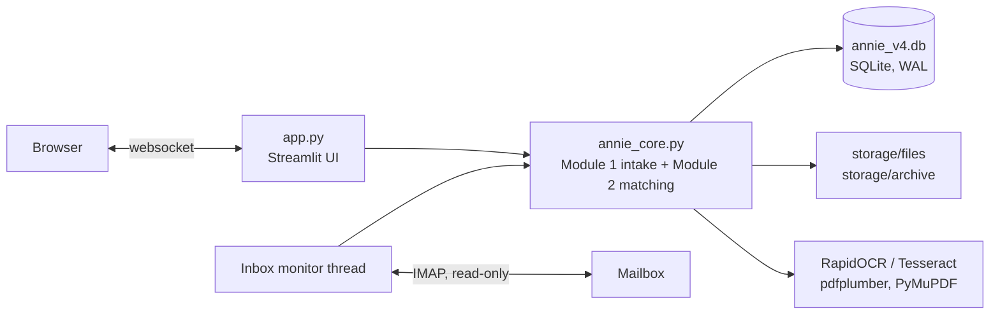
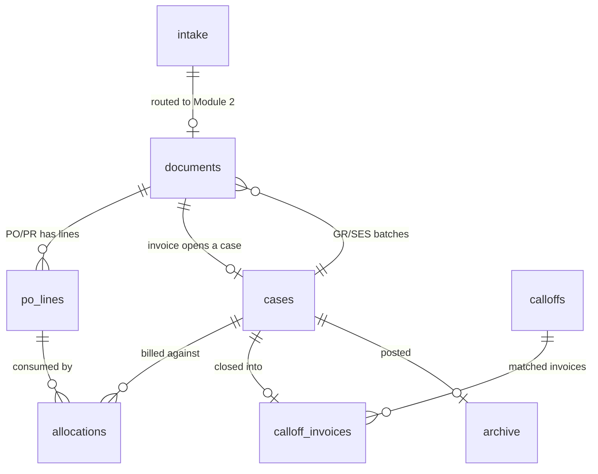
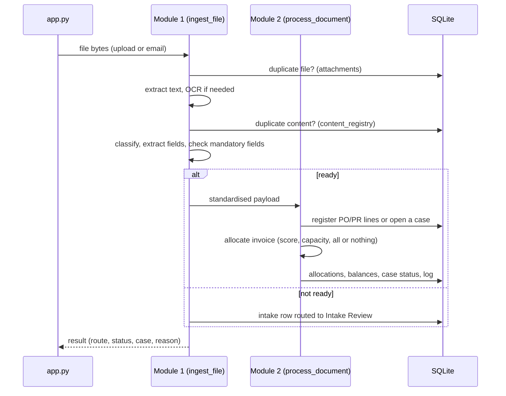

# Annie: technical architecture

How Annie is built, how its parts fit together and how it is deployed. For what the app decides and
why (rules, scoring, thresholds), see [BUSINESS_LOGIC.md](BUSINESS_LOGIC.md).

## Contents

1. [Overview](#1-overview)
2. [Repository layout](#2-repository-layout)
3. [The engine: annie_core.py](#3-the-engine-annie_corepy)
4. [Data model](#4-data-model)
5. [Request flow](#5-request-flow)
6. [Concurrency and state](#6-concurrency-and-state)
7. [The UI layer: app.py](#7-the-ui-layer-apppy)
8. [Configuration](#8-configuration)
9. [Deployment](#9-deployment)
10. [Local development](#10-local-development)
11. [Limitations and technical debt](#11-limitations-and-technical-debt)

---

## 1. Overview

Annie is a single Python process: a **Streamlit** web UI (`app.py`) on top of a plain-Python engine
(`annie_core.py`) that stores everything in one **SQLite** file and a folder of original documents.
There is no separate API server, no external database and no external AI service; extraction and
matching are rule based.



* **Module 1 (intake):** file checks, duplicate detection, text extraction (with OCR), classification,
  field extraction and the mandatory-field gate.
* **Module 2 (matching):** PO/PR registration with line balances, invoice allocation and scoring,
  manual matching, Call-Offs, GR/SES receipts, posting and the archive.

## 2. Repository layout

| Path | Purpose |
|---|---|
| `app.py` | Streamlit UI (about 1,150 lines): pages, presentation helpers, stylesheet |
| `annie_core.py` | The engine (about 2,400 lines): every business rule, the database and the inbox monitor |
| `requirements.txt` | Python dependencies; Streamlit is pinned (`1.66.1`) because the stylesheet targets its element IDs |
| `packages.txt` | System packages for the host: `tesseract-ocr`, `libgl1`, `libglib2.0-0` |
| `.streamlit/config.toml` | Theme colours (kept in step with the stylesheet tokens) |
| `samples/` | 21 sample PO/PRs and invoices; the demo data set |
| `reference_samples/` | Optional reference documents and `reference_labels.json` that tune classification and labels (created empty at start) |
| `Dockerfile`, `.dockerignore` | Container build used by Railway: Python 3.11, Tesseract, OCR models, Streamlit on `$PORT` |
| `deploy/` | Optional self-hosted setup on a VM (systemd + Caddy), for when data must persist |
| `tests/` | Rule tests and the sample-set regression check (see section 10) |
| `docs/` | This document and the business-logic document |
| `annie_v4.db`, `storage/` | Created at runtime; git-ignored |

## 3. The engine: annie_core.py

The file is organised in numbered sections. Each is self-contained enough to read on its own.

| Section | Contents | Key functions |
|---|---|---|
| 1. Imports | Optional dependencies degrade gracefully (OCR, DOCX, HEIC) | |
| 2. Configuration | Paths, thresholds, statuses, mandatory fields, label dictionaries | `MANDATORY`, `DEFAULT_REFERENCE_CONFIG` |
| 3. Database | Schema, migrations for older files, reset | `connect`, `reset_db`, `_log` |
| 4. Module 1 helpers | Hashing, record IDs, content fingerprints, email decoding | `calculate_hash`, `calculate_content_fingerprint` |
| 5. Text extraction | PDF text, OCR fallback, images, DOCX, TXT | `extract_text_from_path`, `ocr_image` |
| 6. Classification | Reference samples, label search, document-type rules | `classify_document`, `extract_labeled_value` |
| 7. Field extraction | Vendor, dates, totals, currency, line items, PO citations, signature | `extract_fields_from_text`, `extract_line_items`, `detect_signature` |
| 8. Cleaning and routing | Normalising values, the Module 1 gate | `clean_record`, `missing_fields` |
| 9. Ingest orchestration | The single entry point for uploads and email, plus the inbox monitor | `ingest_file`, `route_record`, `poll_inbox`, `start_monitor` |
| 10. Intake Review | Re-check, re-extract, dismiss | `reextract_intake`, `dismiss_intake` |
| 11. Similarity and scoring | Text, reference and number similarity; the line score | `text_sim`, `num_sim`, `line_score` |
| 12. Validation helpers | Type normalising, amount detection, case IDs | `_cites_amount`, `_new_case_id` |
| 13. Registration and allocation | PO/PR registration, invoice allocation, retries, case status | `process_document`, `register_po`, `allocate_invoice`, `retry_unallocated`, `refresh_case` |
| 14. Case detail and GR/SES | Allocated lines, receipts, GR/SES numbering and submission | `case_lines`, `submit_gr`, `next_ses_number` |
| 14C. Manual actions | Manual match, unmatch, dismiss | `manual_match`, `unmatch_case`, `delete_invoice_case` |
| 14D. Call-Offs | Call-Off cases, matching and receipts | `confirm_calloff`, `submit_calloff_gr` |
| 14B. Post and archive | ZIP packages, posting | `build_case_package`, `post_case` |
| 15. Read helpers | Rows and counts for the UI | `case_rows`, `po_rows`, `counts`, `list_documents`, `list_log` |

## 4. Data model

One SQLite file (`annie_v4.db`), WAL journal mode, 5-second busy timeout.

| Table | One row per | Notes |
|---|---|---|
| `intake` | Record that entered Module 1 | Channel, file hash, fingerprint, extraction/classification method, Module 1 status, route, extracted JSON, missing fields |
| `attachments` | Distinct file (by SHA-256) | Where the original is stored; drives the duplicate-file check |
| `content_registry` | Distinct content fingerprint | Drives the duplicate-content check |
| `documents` | Document in Module 2 (PO, INVOICE, GR) | `payload` holds the standardised JSON; `outcome` and `case_id` track what happened |
| `po_lines` | Billable PO/PR line | Basis (QTY/AMOUNT/SINGLE), ordered, billed and received running balances |
| `allocations` | Invoice-line to PO-line link | Quantity, amount, score, manual flag and reason |
| `cases` | Invoice | Status, waiting reason, link score, `hold` (after unmatch), `calloff_id` |
| `calloffs`, `calloff_invoices` | Call-Off case; invoice matched to one | |
| `archive` | Posted case | Path to the ZIP package |
| `log` | Event | The audit log shown in the app |
| `mail_messages`, `app_state`, `app_alerts` | IMAP message handled; resume point; user notices | Used by the inbox monitor |



IDs: Module 1 records use a 16-character hash; cases are `CASE-YYYY-NNNN`, Call-Offs
`CALL-YYYY-NNNN`, receipts `GR-YYYY-NNNN` or `SES-YYYY-NNNN`. Serial numbers take the highest number in
use, so deleting a case never causes a clash.

## 5. Request flow



Every state change writes a line to `log`, which is what the Audit Log page shows.

## 6. Concurrency and state

* **One file at a time.** `ingest_file` holds a re-entrant lock, so the inbox monitor and a manual
  upload never run OCR or duplicate checks at the same moment.
* **One inbox scan at a time.** A second lock covers `poll_inbox`; "Check inbox now" waits for a running scan.
* **Inbox monitor.** A daemon thread with its own database connection scans every `POLL_SECONDS`
  (default 60, clamped to 15 to 3,600). The mailbox is opened read-only, mail is never marked as read,
  each IMAP UID is handled once, and the resume point only advances after a clean scan. The UI polls
  every 10 seconds (a Streamlit fragment) and reruns when the monitor has new results.
* **SQLite.** WAL mode and a busy timeout let the UI and the monitor share the file.
* **Streamlit model.** The script reruns on every interaction; per-browser state lives in
  `st.session_state` (current page, opened case, session results, PIN entry). The database is shared
  by all users of the deployment.
* **Demo auto-load.** `demo_autoload` is wrapped in `st.cache_resource`, so it runs once per process
  (and again when its code changes). On Streamlit Community Cloud it resets the database and ingests
  `samples/*.pdf` through the normal upload path, so every restart or redeploy opens a clean demo;
  locally it only fills an empty database (see `DEMO_AUTOLOAD`).
* **What is cached.** Database reads take well under a millisecond, so they are not cached; caching
  them would only risk stale lists. PDF previews are the expensive part: `pdf_pages` renders each page
  to a PNG once with PyMuPDF (`st.cache_data`, keyed on path and modification time) and the browser
  shows plain images instead of running a PDF viewer on every rerun.
* **Forms.** Inputs that belong to one action (manual match table and reason, Unmatch, Dismiss, the
  Call-Off reason, the admin PIN, GR/SES batches) sit in `st.form`, so editing them does not rerun the
  page until the action button is pressed.

## 7. The UI layer: app.py

**Structure.** Section 1 sets up the connection, settings and demo auto-load. Section 2 holds shared
helpers. Section 3 renders the detail pages (case, PO/PR, Call-Off). Section 2B is the stylesheet and
the navigation. Sections 4 to 12 render one page each: Dashboard, Submit Document, Intake Review,
Processing, Documents, Complete Archive, Audit Log and Controls. Navigation is held in session state
(`ss.side`, `ss.ptab`, `ss.view_case`, `ss.view_po`) rather than URLs.

**Presentation helpers** keep pages consistent: `pill` (status pill), `cell` and `head_row` (table
cells that render as plain text, so values such as "-" never turn into Markdown), `page_head` (detail
header), `pretty` and `_label` (readable column names), `nice` and `md` (display-safe codes and file names).

**Navigation and flow.** The sidebar follows the AP process: Dashboard, then *Workflow* (Submit Document,
Intake Review, Processing, Complete Archive), *Records* (Documents, Audit Log) and *Admin* (Controls).
Processing tabs run Stage 1, Call-Offs, Stage 2, Stage 3, because a confirmed Call-Off moves to Stage 2.
Each dashboard figure is a button that opens the page or stage holding those items.

**Design system.** All colours are CSS custom properties on `:root`: a neutral scale, one blue accent,
and green, amber and red used only for status. The accent marks where you are (current page, active
stage, chosen items) and links. Status pills have three meanings: needs action (amber), done (green)
and in progress (neutral); dashboard figures use the same colours, and only when the count is above
zero. Notes carry a thin left strip in their colour. Streamlit's theme in `.streamlit/config.toml`
uses the same values.

**Icons.** Streamlit draws icons as ligatures in the Material Symbols font, so before that font loads
an icon reads as its name (for example `keyboard_double_arrow_right`). The stylesheet keeps icons
transparent and one glyph wide until a small script confirms the font has loaded, and the sidebar
open/close buttons draw their own chevrons, so they never depend on the font.

**Styling hooks.** Streamlit adds a `st-key-<key>` class to keyed elements; the stylesheet uses these
as stable hooks:

| Key pattern | Used for |
|---|---|
| `side_*` | Sidebar navigation items |
| `ptab_*`, `ptabs` | Processing stage tabs |
| `tbl_*` | Row tables (header and rows scroll sideways together on narrow screens) |
| `ctl_*` | Filter / sort / order / count controls |
| `card_*` | White section cards (`card_danger` for the reset area) |
| `detail_cols` | Detail-page columns that stack on tablets |
| `polink_*`, `reset_db`, `demo_reload` | PO/PR links and the admin buttons |
| `tiles`, `tile_*`, `tilebtn_*` | Dashboard figures; the button is stretched invisibly over its card |
| `preview_*` | Scrolling PDF preview panes |

**Responsive rules.** At 1,024 px and below, detail pages stack; at 768 px and below, the sidebar is a
drawer that closes after a page is chosen (a small script added with `st.html`); at 640 px and below,
dashboard cards go two per row and filter controls wrap.

## 8. Configuration

Settings come from environment variables (Railway Variables, or a `.env` file locally or on a VM) or
Streamlit secrets (on Community Cloud). Root-level Streamlit secrets are also exposed as environment variables.

| Setting | Default | Purpose |
|---|---|---|
| `ADMIN_PIN` | not set | Unlocks *Reset & load demo data* and *Reset database*. Without it both stay locked. |
| `DEMO_AUTOLOAD` | `reset` on Community Cloud, `1` elsewhere | At start: `reset` clears the database and loads the sample documents; `1` loads them only into an empty database; `0` never. |
| `EMAIL_HOST`, `EMAIL_ADDRESS`, `EMAIL_PASSWORD` | not set | IMAP account for email intake (all three required) |
| `EMAIL_PORT` | `993` | IMAP over SSL |
| `EMAIL_MAILBOX` | `INBOX` | Folder to scan |
| `EMAIL_SUBJECT_FILTER` | empty | Only process mail whose subject contains this text |
| `EMAIL_LOOKBACK_DAYS` | `30` | How far back the first scan looks |
| `POLL_SECONDS` | `60` | Scan interval (15 to 3,600) |
| `EMAIL_AUTO_FETCH` | `1` | Start the monitor automatically |

## 9. Deployment

**Current: Railway** at `anniev5-production.up.railway.app` (always on; the trial credit covers 30
days or $5, then the Hobby plan). The service deploys the `ui-polish` branch (the fork's default branch)
and redeploys on every push. Railway detects the `Dockerfile` and builds it; config-as-code files are
no longer read for new services, so the remaining settings live in the Railway dashboard:

* **Networking.** A generated `*.up.railway.app` domain routes to port 8080, the `PORT` Railway gives
  the container; the Dockerfile starts Streamlit on `$PORT`.
* **Health and restarts.** Healthcheck Path `/_stcore/health`; restart policy *On Failure*.
* **Storage is not persistent** (no volume). Each deploy starts an empty database, which demo
  auto-load fills with the sample set on the first visit. Changes visitors make last until the next
  deploy or restart, or until *Reset & load demo data*.
* **Access.** The app is public. Visitors can browse, open cases and upload; destructive admin actions
  need `ADMIN_PIN`, set under the service's Variables.

**Earlier host: Streamlit Community Cloud** (`annie-acct439.streamlit.app`). It is free but sleeps
after 12 hours without visitors, and since November 2026 it does not render for headless browsers, so
the automated keep-awake job that used to visit it was removed.

**Alternative: a self-hosted VM** (`deploy/`). `setup.sh` installs the app on Ubuntu 24.04 (for example
an Oracle Cloud Always Free ARM VM) with a systemd service, Caddy for HTTPS on a free `sslip.io`
hostname, optional browser login and firewall rules. Data then lives on the VM's disk and survives
restarts. See `deploy/README.md`.

## 10. Local development

```bash
python3.11 -m venv .venv && source .venv/bin/activate
pip install -r requirements.txt
streamlit run app.py
```

Use Python 3.11 or 3.12; very new versions may lack prebuilt wheels for `onnxruntime` and PyMuPDF.
Scanned documents need RapidOCR (installed from `requirements.txt`) or a system Tesseract. Set
`ADMIN_PIN` in `.env` to use the reset buttons locally. Delete `annie_v4.db` and `storage/` (or use
*Reset database*) to start clean.

**Tests** (plain Python; `pytest tests/` also works). Both run in a temporary folder and never touch
the real database:

```bash
python tests/test_findings.py      # rules: currency, tax, duplicate references
python tests/sample_regression.py  # the 21 samples still produce the outcomes in expected_samples.json
```

`sample_regression.py` loads the sample set into an empty Annie and compares routing, matching outcomes,
final case and PO/PR states and waiting reasons with a snapshot (see
[BUSINESS_LOGIC.md, section 8](BUSINESS_LOGIC.md#8-the-sample-documents-and-what-they-demonstrate)).
Run it after every change to `annie_core.py`. If a change is meant to alter outcomes, review the
differences it prints, then accept them with `--update`.

## 11. Limitations and technical debt

* **Single process, single file.** SQLite and in-process threads suit one instance; scaling out would
  need a shared database and a separate worker for the inbox monitor.
* **No user accounts.** Only the admin reset actions are protected (by a shared PIN). Every visitor
  shares the same data.
* **Rule-based extraction.** Labels, title patterns and table parsing are tuned to the sample layouts.
  New supplier formats may need label aliases or reference samples (`reference_samples/`).
* **UI coupling to Streamlit internals.** The stylesheet relies on Streamlit's `data-testid` attributes,
  which is why Streamlit is pinned; upgrade deliberately and re-check the UI.
* **Open business-logic questions** (date checks, day-first dates, near-duplicate invoice numbers and
  others) are listed in [BUSINESS_LOGIC.md, section 9](BUSINESS_LOGIC.md#9-review-findings).
* **Test coverage is targeted.** The rule tests cover the November 2026 fixes; the sample regression
  covers the main matching paths end to end. Extraction on new document layouts is not covered.
