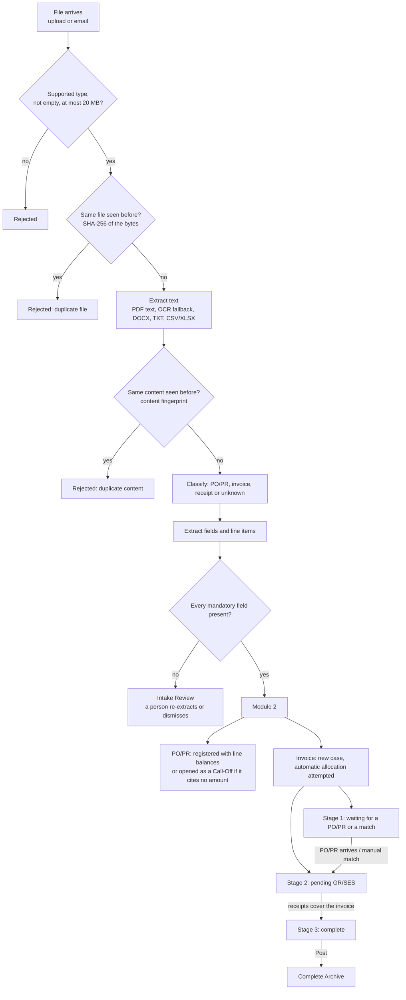
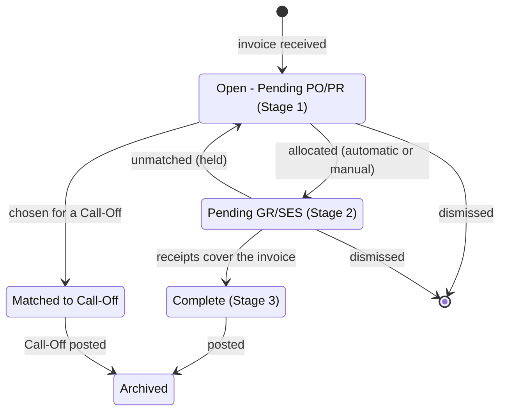

# How Annie works: business logic

This document explains, in plain terms, every decision Annie makes between a document arriving and
a case being archived: what is checked, how matches are scored, which thresholds apply and why an
item ends up where it does. All numbers below are taken from the code (`annie_core.py`); the
section and function names are given so each rule can be traced.

For how the system is built (components, data model, deployment), see
[ARCHITECTURE.md](ARCHITECTURE.md).

## Contents

1. [The flow at a glance](#1-the-flow-at-a-glance)
2. [Module 1: intake](#2-module-1-intake)
3. [Module 2: matching](#3-module-2-matching)
4. [Goods receipt and service entry (GR/SES)](#4-goods-receipt-and-service-entry-grses)
5. [Posting and the archive](#5-posting-and-the-archive)
6. [Status lifecycles](#6-status-lifecycles)
7. [Thresholds and constants](#7-thresholds-and-constants)
8. [The sample documents and what they demonstrate](#8-the-sample-documents-and-what-they-demonstrate)
9. [Review findings](#9-review-findings)

---

## 1. The flow at a glance

Annie works in two modules. **Module 1** turns a file into a clean, validated record. **Module 2**
matches invoices to purchase orders / purchase requisitions (PO/PRs), tracks what has been billed and
received against each PO/PR line, and closes cases once goods or services are confirmed received.

Only two document types are processed end to end: **PO/PRs** and **supplier invoices**. Receipts are
recognised but routed to Intake Review as out of scope.

---

## 2. Module 1: intake

Function: `ingest_file` (section 9). Every upload and every email attachment goes through the same
path, one file at a time (a lock prevents the inbox monitor and a manual upload from racing).

### 2.1 Basic file checks

| Check | Rule | Result if it fails |
|---|---|---|
| File type | `.pdf .csv .xlsx .txt .docx` or an image (`.png .jpg .jpeg .tif .tiff .bmp .webp .heic .heif`) | Rejected |
| Size | Not empty, at most 20 MB | Rejected |

### 2.2 Duplicate check 1: identical file

The SHA-256 hash of the file bytes is compared with every file already received. An identical file is
rejected as `DUPLICATE_FILE` and never processed again. The original is kept under
`storage/files/<first 10 hash characters>_<file name>`.

### 2.3 Text extraction

| Source | Method |
|---|---|
| PDF with a text layer | Text is read directly (`PDF_TEXT`). |
| Scanned PDF | If the text layer has fewer than **25** usable characters, each page is rendered at 2.2x and read with OCR (`PDF_OCR`). |
| Image | OCR on every frame (`IMAGE_OCR`); HEIC is supported. |
| DOCX | Paragraphs and table cells. |
| TXT | Read as is. |
| CSV / XLSX | Each row becomes a record; column headers are mapped to field names (for example "Supplier Name" to vendor). |

OCR uses **RapidOCR** (ONNX) when installed, otherwise **Tesseract**. Images are converted to greyscale,
auto-contrasted and scaled to at least 1,800 px wide first.

### 2.4 Duplicate check 2: same content in a different file

A content fingerprint is built from the extracted text (upper-cased, only letters and digits kept,
then hashed). If a *different* file produces the same fingerprint (for example the same invoice
re-saved or re-scanned), it is rejected as `DUPLICATE_CONTENT`. Text shorter than 25 characters gets
no fingerprint, so this check is skipped for it.

### 2.5 Classification

Function: `classify_document` (section 6). The rules are tried in order; the first one that decides wins.

1. **Explicit label.** A "Document Type", "Document Category" or "Type" field whose value contains a
   known alias (for example "purchase requisition", "tax invoice", "receipt").
2. **Title.** In the first 25 lines, a line starting with "Purchase Order" / "Purchase Requisition"
   (PO/PR), "Invoice" with an optional Tax/Sales/Supplier/Commercial/Travel prefix (invoice), or
   "Receipt" / "Payment Receipt".
3. **Keyword.** The word "invoice" in the first 25 lines, and no "purchase order/requisition".
4. **Similarity to reference samples.** If reference samples are configured (`reference_samples/`),
   the document's words (3+ letters, common words removed) are compared with each sample:

   `similarity = shared words / all distinct words in both` (Jaccard index)

   The best sample's type is used only if **all** of these hold: similarity at least **0.18**, at
   least **3** shared words, and at least **2** recognised fields (supplier, invoice number, PO
   number, PO reference, date or amount) found in the document.
5. Otherwise the type is **UNKNOWN** and the document goes to Intake Review.

### 2.6 Field extraction

Function: `extract_fields_from_text` (section 7).

* **Labelled fields.** Each field has a list of label spellings (for example the vendor can appear as
  "Supplier", "Vendor Name", "Issued By", "Seller", "From"). The value is taken from the same line
  after the label, or from the next two lines when the label stands alone (two-column layouts).
  Reference fields must contain a digit and must not be a column word such as "Total" or "SGD".
* **Vendor without a label.** The first header line with a legal suffix (Pte Ltd, Ltd, LLC, GmbH and so
  on), or else a company-like word (Services, Supplies, Trading...). Lines naming our own company
  (Northwind Holdings) or a "Bill to / Customer" block are skipped.
* **Date.** The labelled date, or else the first date in the first 40 lines. Ambiguous numeric dates
  are read **day first** (03/04/2026 is 3 April 2026).
* **Total and currency.** The labelled total, or else the last "Total ... 0.00" in the text, or else
  the sum of the line totals. Currency comes from a code (SGD, USD, EUR, GBP, MYR, AUD, JPY, CNY) or an
  unambiguous symbol (S$ means SGD, US$ means USD, plus the euro and pound signs). A bare "$" is left
  as *unknown*, because it could be SGD, USD or another dollar.
* **Subtotal and tax.** When a document prints them on their own lines ("Subtotal 3,000.00",
  "GST 9%: SGD 270.00", also VAT and Sales tax), both amounts are kept. "GST Reg No" lines and the
  "Tax Invoice" title are ignored. They are used to bill PO/PR balances before tax (section 3.3).
* **Line items.** The first table whose header has a description-type column and a quantity/amount
  column. A goods row is `description  qty  unit price  total`; a service row is a description with a
  single amount. Reading stops at Subtotal/Total/Prepared by/Payment terms/Bank.
* **Goods or services (PO/PRs).** A ticked "Goods"/"Services" box (X, check marks or `[x]`), or else
  goods if there are priced rows and services if there is only a service description.
* **PO/PRs cited on an invoice.** The labelled PO reference(s), every known PO/PR number found anywhere
  in the text, and per-line prefixes (an invoice line starting with a PO number is tied to that PO).
* **Signature (PO/PRs only).** Pages are rendered as images. Annie looks in the lower-left area for a
  horizontal signature line (dark run at least 12% of the page width, below the middle of the page).
  The band just above that line counts as signed if at least **0.2%** of its pixels are dark ink, or
  if OCR reads at least 2 characters there. With no line found, a fixed lower-left box is checked.

### 2.7 The Module 1 gate (the only gate)

A document enters Module 2 only when it is a PO/PR or invoice **and every mandatory field is present**.

| PO/PR (all required) | Invoice (all required) |
|---|---|
| PO reference | Invoice reference |
| Cost centre | Vendor name |
| Date | Date |
| Vendor name | Lines |
| Approver name and job title | Total |
| Prepared by name and job title | |
| Goods/Services tick | |
| Signature present | |
| Lines | |

"Lines" means: for **goods**, every item has a description, quantity, unit price and total (a goods
PO/PR that cites no amounts only needs descriptions, because it will become a Call-Off); for
**services**, a service description that is not "N/A". An invoice does **not** need to cite a PO.

| Module 1 status | Meaning | Goes to |
|---|---|---|
| `READY_FOR_MODULE_2` | Type known, all mandatory fields present | Module 2 |
| `READY_WITH_GAPS` | Type known, some mandatory fields missing | Intake Review |
| `UNCLASSIFIED_ERROR` | Type could not be determined (or processing failed) | Intake Review |
| `UNREADABLE_DOCUMENT` | No usable text extracted | Intake Review |
| `UNSUPPORTED_DOCUMENT` | Readable but out of scope (for example a receipt) | Intake Review |
| `DUPLICATE_REFERENCE` | Passed every check, but Module 2 already holds its PO/PR reference or invoice number (section 3.1 and 3.2) | Intake Review |

**Intake Review actions.** *Re-extract from file* re-runs extraction (useful after the extraction rules
or reference samples improve) and routes the document again. *Dismiss* deletes it and forgets its hash
and fingerprint, so the same file can be submitted again later.

---

## 3. Module 2: matching

Entry point: `process_document` (section 13).

### 3.1 Registering a PO/PR

* **Unique reference.** A PO/PR whose reference matches one already registered (ignoring case,
  spaces and punctuation) is not registered (`REJECTED_PO_REFERENCE_EXISTS`). It goes to **Intake
  Review** as `DUPLICATE_REFERENCE` with the reason, so a person can dismiss it (which also lets the file
  be submitted again) instead of it disappearing.
* **No amount cited means Call-Off.** If the PO/PR has no total above zero and no unit price or line
  total on any item, it is not given line balances. It opens a **Call-Off case** (`CALL-YYYY-NNNN`)
  that is matched by hand to one or more invoices (section 3.8).
* **Otherwise** each billable line is stored with a running balance (ordered, billed, received) and one
  of three bases:

| Basis | When | Measured in |
|---|---|---|
| `QTY` | Goods with priced items | Quantity |
| `AMOUNT` | Services (or goods without item lines) with a total above zero | Money, before tax; several invoices may bill against it |

After registering, Annie **retries every waiting invoice**, oldest first (`retry_unallocated`), because
the new PO/PR may be the one they were waiting for.

### 3.2 Receiving an invoice

* **Unique invoice number per vendor.** If an invoice with the same number (ignoring case, spaces and
  punctuation) is already in Module 2 **and** the vendor names are at least **0.90** similar, the new one
  is not accepted (`REJECTED_INVOICE_NUMBER_EXISTS`). This stops one invoice consuming PO balance twice.
  Like a repeated PO/PR reference, it goes to **Intake Review** as `DUPLICATE_REFERENCE` with the reason.
* Otherwise a **case** is opened (`CASE-YYYY-NNNN`, numbered per year) in Stage 1 and automatic
  allocation is attempted.

### 3.3 Automatic allocation

Function: `allocate_invoice`. Allocation is **all or nothing**: every invoice line must find a PO/PR
line, or the whole invoice waits in Stage 1 with a reason.

**Step 1: cited PO/PRs must exist.** If the invoice cites a PO/PR that has not arrived yet, it waits
("PO/PR not yet received"). If it cites a Call-Off PO/PR, it waits for a manual Call-Off match.

**Step 2: candidate PO/PR lines.** For each invoice line, a PO/PR line is a candidate only if:

* the vendor names are at least **0.90** similar (`VENDOR_AUTO`), after legal endings such as Pte, Ltd, Sdn Bhd,
  LLC and Inc are dropped ("ABC Pte. Ltd." and "ABC Private Limited" both compare as "abc"),
* the line still has an open balance,
* the **currency is the same** as the invoice's (only checked when both documents state a currency;
  an unknown currency never blocks), and
* if the invoice line names a PO/PR, the line belongs to it; otherwise, if the invoice cites any
  PO/PRs, the line belongs to one of them; an invoice that cites nothing may match any PO/PR of that
  vendor.

**Guard rails on goods lines** (`line_problems`). The score decides which line an invoice line belongs
to; these checks decide whether it may be billed without a person looking. A goods (`QTY`) line is held
in Stage 1 with the reason shown if any of these is true, even when the invoice cites the PO/PR:

* the description does not resemble the PO/PR item (`desc_match` below **0.40**),
* the unit price is more than **5%** above the PO/PR price (lower prices are not blocked), or
* the line total is more than quantity x unit price (0.5% plus 0.05 allowed for rounding; discounts
  are not blocked).

Services are not checked, because their wording legitimately differs ("Milestone 1" and "Annual
project"). Manual match can still accept a held line, with a typed reason.

**Step 3: score each candidate** (`line_score`):

* If the invoice cites this PO/PR **and** it has exactly one line left to bill, the score is **1.0**.
* Otherwise:

  `score = 0.6 x description similarity + 0.4 x unit-price similarity`

  The price part applies to goods (`QTY`) lines only. For service lines the description alone
  decides (weights are re-balanced over the parts that exist, so a missing part is never a penalty).
* If the invoice cites the PO/PR, **+0.25** is added (the result is capped at 1.0).

**Description similarity** (`text_sim`): both texts are lower-cased and stripped of punctuation;
the score is the higher of (a) character-sequence similarity and (b) word overlap
(shared words / all distinct words). Word overlap means word order does not matter.

**Unit-price similarity** (`num_sim`): `1 - 10 x |a - b| / max(a, b)`, never below 0. Equal prices
score 1.0, a 5% difference about 0.52, and a difference of 10% of the higher price or more scores 0.

**Step 4: accept and check capacity.** A candidate is acceptable at **0.80 or more**
(`LINK_THRESHOLD`). Among acceptable candidates, the highest score with enough open balance is used
(ties go to the earliest PO/PR line). Capacity is the open quantity for goods, the open amount for
services by amount (0.005 tolerance).

**Amounts are compared before tax** (`net_total`). For a service PO/PR and for an invoice billed as one
amount, Annie uses the subtotal when the document prints one, or else the total minus the GST/VAT line,
or else the total. So an invoice of 3,000.00 + 270.00 GST bills 3,000.00 against a PO/PR written for
3,000.00 instead of being flagged as overbilling. Goods lines compare quantities and unit prices, which
are before tax already. The app still displays each document's gross total. Balances are
reserved line by line within the same invoice, so two lines cannot both use the same remaining quantity.

**Step 5: commit.** When every line is placed, the billed quantities/amounts are added to the PO/PR
lines and the case moves to Stage 2. The **case link score** shown in the app is the **average** of
its line scores (each line already had to reach 0.80 on its own).

#### Worked examples from the sample data

| Invoice | What happened | Score |
|---|---|---|
| BE-2026-014 (BrightEdge, cites PR-2026-0302) | The cited PO/PR has one open line, so the rule gives 1.0 | 1.00 |
| AOS-INV-31001 (Acme, cites PR-2026-0301) | Each line is similar on description and price, plus the citation bonus, capped | 1.00 |
| AOS-INV-31044 (Acme, cites nothing) | "A4 Paper 80gsm - Ream" vs "A4 Copier Paper 80gsm (ream)": 0.6 x 0.844 + 0.4 x 1.000 = **0.9067**. "Stapler, Heavy Duty" vs "Heavy Duty Stapler": same words, same price = **1.0** | 0.9533 (average) |

The Acme names "Acme Office Supplies Pte Ltd" and "Acme Office Supplies" are 0.833 similar, which
passes the 0.70 vendor gate.

### 3.4 Why an invoice waits in Stage 1

The case shows one or more of these reasons:

| Reason shown | Meaning |
|---|---|
| `PO/PR not yet received: PR-...` | The invoice cites a PO/PR Annie has not seen. It is retried automatically when the PO/PR arrives. |
| `PR-... is a Call-Off PO/PR (no amount cited)` | Match it by hand from the Call-Offs tab. |
| `'<line>' matches no open PO line (best 0.xx)` | Candidates exist but none reach 0.80. |
| `'<line>' matches no open PO line: PR-... has nothing left to bill` | The vendor's PO/PRs are fully billed. |
| `'<line>' matches no open PO line: vendor name on PR-... is similar but not close enough (0.xx, needs 0.90) - check it and use Manual match` | A PO/PR exists for a vendor name 0.70-0.89 similar. Annie never bills it automatically; a person checks it is the same vendor. |
| `'<line>' matches no open PO line (no PO/PR for this vendor)` | No open PO/PR with a vendor name at least 0.70 similar. |
| `'<line>' matches no open PO line: PR-... is in SGD but the invoice is in USD` | The only candidates are in another currency. |
| `'<line>' is held for review - PR-...: <reason>` | A goods line failed a guard rail: wrong item, price too high or line total too high. Match it by hand if it is correct. |
| `'<line>' bills 4 but PR-... has only 3 left to bill` | A good match, but the invoice asks for more than is left: **overbilling**. |

### 3.5 Retry order

Waiting invoices are retried, oldest case first, whenever a PO/PR is registered and after an invoice is
dismissed or unmatched (both give balance back). Older invoices therefore get first claim on balance.
Cases a user has unmatched are **held** and are not retried automatically.

### 3.6 Manual match (Stage 1)

For invoices that do not match automatically, a user picks the PO/PR line for each invoice line
(`manual_match`). Rules:

* Each invoice line must end up **exactly 100%** allocated; one invoice line may be split over several
  PO/PR lines.
* Goods lines take a quantity; services by amount take an amount.
* Open balances still apply; you cannot bill more than is left.
* A PO/PR line in a different currency from the invoice cannot be chosen (it is left out of the picker
  and refused if submitted).
* Annie shows the automatic score for each choice and warns when it is below 0.80, when the vendor
  similarity is below 0.70, or when a guard rail fails. You may still confirm, but **a typed reason of at least 5 characters is
  required** and is stored with the allocation and in the audit log.

### 3.7 Unmatch and dismiss

* **Unmatch** (Stage 2 only, reason required): reverses the billing on the PO/PR lines, voids any
  GR/SES batches raised for this match (their received quantities are given back), returns the invoice
  to Stage 1 and **holds** it so it is not re-matched automatically.
* **Dismiss** (Stage 1 or 2): deletes the invoice, reverses its billing, voids its GR/SES batches and
  forgets the file hash so it can be resubmitted. An audit log line is kept.

### 3.8 Call-Offs

A PO/PR that cites no amount (for example a framework or market-price order) opens a Call-Off case.
Call-Offs are **never matched automatically**. A user selects the invoices that bill against it
(sorted by vendor similarity, with a warning below 0.70 and a warning when the currencies differ),
types a reason (at least 5 characters) and confirms. The invoices become *Matched to Call-Off* and the Call-Off case moves to Pending GR/SES.

---

## 4. Goods receipt and service entry (GR/SES)

Functions: `submit_gr`, `submit_calloff_gr` (section 14). A GR (goods) or SES (services) records what
was actually received or performed. It can be raised in several batches.

* **Numbering** is automatic: `GR-YYYY-NNNN` for goods and `SES-YYYY-NNNN` for services, per year.
* **Prepared by must match the PO/PR's preparer** (an approved-requester control).
* **Service dates** (from and to) are required, and the end date cannot be before the start date.
* **Cap per line:** you cannot receive more than this invoice still needs on that line, nor more than
  the PO/PR line has left to receive overall.
* **Value:** goods are valued at the PO/PR unit price x quantity received; services by the amount entered.
* **Completion:** the case becomes **Complete** when this invoice's own receipts cover everything it
  billed on every allocated PO/PR line (receipts for other invoices on the same PO/PR do not count).
  A Call-Off is complete when receipts cover every line of every matched invoice.

---

## 5. Posting and the archive

**Post** is available on Complete cases. It builds a ZIP package and moves the case to the Complete
Archive: the invoice and every matched PO/PR in their original format, each GR/SES batch as JSON, an
`allocations.json` (what was billed and received per PO/PR line, with scores) and a `case_summary.json`.
The package can be downloaded again from the archive at any time.

---

## 6. Status lifecycles

**Invoice case**

**PO/PR position** (shown in "PO/PRs with open balance"): *Open - Pending Invoice* (nothing billed yet),
*Partly billed* (some lines still open), *Fully billed* (nothing left to bill; it leaves the list).

**Call-Off case:** *Open - Call-Off* then *Pending GR/SES* after invoices are matched, then *Complete*
when receipts cover them, then *Archived* when posted.

**Dashboard and tab counts:** Open = invoices waiting in Stage 1 plus PO/PRs that are not fully billed;
Pending GR/SES and Complete include Call-Off cases in those states.

---

## 7. Thresholds and constants

| Constant | Value | Where | Meaning |
|---|---|---|---|
| `MAX_FILE_SIZE` | 20 MB | Module 1 | Largest accepted file |
| `MIN_USABLE_TEXT_CHARACTERS` | 25 | Module 1 | Below this, a PDF is OCR'd and no content fingerprint is made |
| `classification_threshold` | 0.18 | Module 1 | Minimum similarity to a reference sample (plus 3 shared words, 2 fields) |
| `SIGNATURE_INK_RATIO` | 0.002 | Module 1 | Share of dark pixels above the signature line that counts as signed |
| `LINK_THRESHOLD` | 0.80 | Module 2 | Minimum line score for an automatic match |
| `LINE_W` | description 0.6, price 0.4 | Module 2 | Line score weights |
| `CITATION_BONUS` | +0.25 | Module 2 | Added when the invoice cites the PO/PR |
| `PRICE_TOLERANCE` | 5% | Module 2 | How far a goods unit price may exceed the PO/PR price before the line is held |
| `ARITH_TOLERANCE` | 0.5% + 0.05 | Module 2 | How far a goods line total may exceed quantity x unit price before the line is held |
| `DESC_FLOOR` | 0.40 | Module 2 | Minimum resemblance between a goods invoice line and the PO/PR item |
| `VENDOR_AUTO` | 0.90 | Module 2 | Minimum vendor-name similarity for automatic allocation (legal endings ignored) |
| `VENDOR_MIN` | 0.70 | Module 2 | Warning level in manual and Call-Off matching; below it the vendor name "looks different" |
| Duplicate invoice vendor check | 0.90 | Module 2 | Vendor similarity for "same invoice number from the same vendor" |
| `ENFORCE_UNIQUE_INVOICE_NUMBER` | on | Module 2 | Reject a repeated invoice number from the same vendor (sent to Intake Review) |
| Currency rule | same code, or one unknown | Module 2 | An invoice is never billed against a PO/PR in another currency |
| Amount tolerance | 0.005 | Module 2 | Rounding allowance for money balances |
| Reason length | 5 characters | Module 2 | Minimum typed reason for manual match, unmatch and Call-Off confirmation |

---

## 8. The sample documents and what they demonstrate

The `samples/` folder holds 28 PDFs, loaded automatically into an empty demo database. Processed in
file-name order, they produce:

| Files | Scenario | Outcome |
|---|---|---|
| P01, P02, P03 | Acme goods PO; invoice citing it; second partial invoice citing nothing | PO registered; both invoices allocated (P03 found by similarity, score 0.95) |
| P04, P05, P06 | BrightEdge services PO by amount; two milestone invoices | Both milestones billed against the amount |
| P07, P08, P09 | Zenith: one invoice citing two PO/PRs that arrive later | Invoice waits ("PO/PR not yet received"), then allocates across both when they arrive |
| P10, P11 | BrightPrint: invoice bills 4 banners, PO has 3 | Waits: overbilling caught |
| P12, P13, P14, P31 | PestGuard service PO with no amount; invoices; one with different wording and no PO cited | Call-Off opened; the invoices wait in Stage 1 until someone matches them to it |
| P60, P61 | CoolBreeze aircon service; invoice citing no PO, from "CoolBreeze Aircon **Services** Pte Ltd" | Waits in Stage 1: vendor name 0.79 similar, under 0.90; match it by hand |
| P62, P63 | Lenscape photography; invoice above the PO amount | Waits: overbilling caught |
| P64, P65 | GreenGrocer market-price ingredients (no amount) | Call-Off; invoice waits for a manual match |
| S09 | Orion courier invoice with no invoice number or date | Held in Intake Review: mandatory fields missing |
| T1 (PO and invoice) | Bolts billed at 7.50 against a PO/PR price of 2.50 | Held in Stage 1: price too high |
| T2 (PO and invoice) | Consulting hours billed against a toner PO/PR | Held in Stage 1: wrong item |
| T3 (PO and invoice) | 10 chairs at 50.00 with a line total of 999.00 | Held in Stage 1: line total too high |

---

## 9. Review findings

A review of the business logic (November 2026). Findings 1 to 3 and 6 are **fixed**; the rest need a
decision from the team before anything changes.

| # | Area | Finding | Impact | Status or suggestion |
|---|---|---|---|---|
| 1 | Matching | **Currency was extracted but never compared.** A USD invoice could be matched to an SGD PO/PR. | Medium | **Fixed.** A PO/PR line in another currency is not a candidate; manual match refuses it; Call-Off matching warns. A bare "$" now counts as unknown instead of USD, so Singapore "$" documents are not wrongly blocked. |
| 2 | Matching | **Tax was not separated.** For services billed by amount, an invoice including GST/VAT was compared with a PO/PR amount without it, so a correct invoice looked overbilled. | Medium | **Fixed.** Subtotal and GST/VAT lines are extracted and PO/PR balances are billed before tax (section 3.3). Genuine overbilling is still caught. |
| 3 | Module 2 | **Rejected duplicates were a dead end.** A document whose PO/PR reference or invoice number already existed had no case, did not appear in Intake Review, and could not be re-uploaded. | Medium | **Fixed.** It now goes to Intake Review as `DUPLICATE_REFERENCE` with the reason; dismissing it frees the file to be submitted again. |
| 4 | Matching | **No date checks.** An invoice dated before its PO/PR, or service dates outside the PO/PR period, are not flagged. | Low | Warn on invoice-before-PO and on out-of-period service dates. |
| 5 | Intake | **Day-first dates.** Ambiguous numeric dates are read day first, so a US-format 03/04/2026 becomes 3 April. | Low | Keep, but document per supplier or detect the format from unambiguous dates. |
| 6 | Module 2 | **"Single invoice" basis was rarely used.** PO/PRs with no amount already opened Call-Offs, so it only applied to a services PO/PR that priced a line but stated a zero total. | Info | **Fixed.** The basis was retired; such a PO/PR now opens a Call-Off. |
| 7 | Code comment | The price-similarity comment says "a 10% gap scores 0". Exactly, a gap of 10% of the **higher** price scores 0; a 10% gap measured on the lower price scores about 0.09. Behaviour is fine. | Info | Correct the comment. |
| 8 | Duplicates | The duplicate-invoice check is exact on the number, so a reissued invoice with a changed number (INV-001 vs INV-001A) is not caught. | Low | Optionally warn on near-identical numbers with the same vendor and amount. |
| 9 | Allocation | Balance is first come, first served: the oldest waiting invoice claims limited balance even if a newer invoice matches better. | Info | Expected behaviour; noted for awareness. |

Display issues found during the same review were fixed in the app: the dashboard count no longer
includes generated GR/SES forms, the "Complete" card no longer says "archived", and a Processing caption
that said PO/PRs without an amount expect one invoice now says they are handled in Call-Offs.
